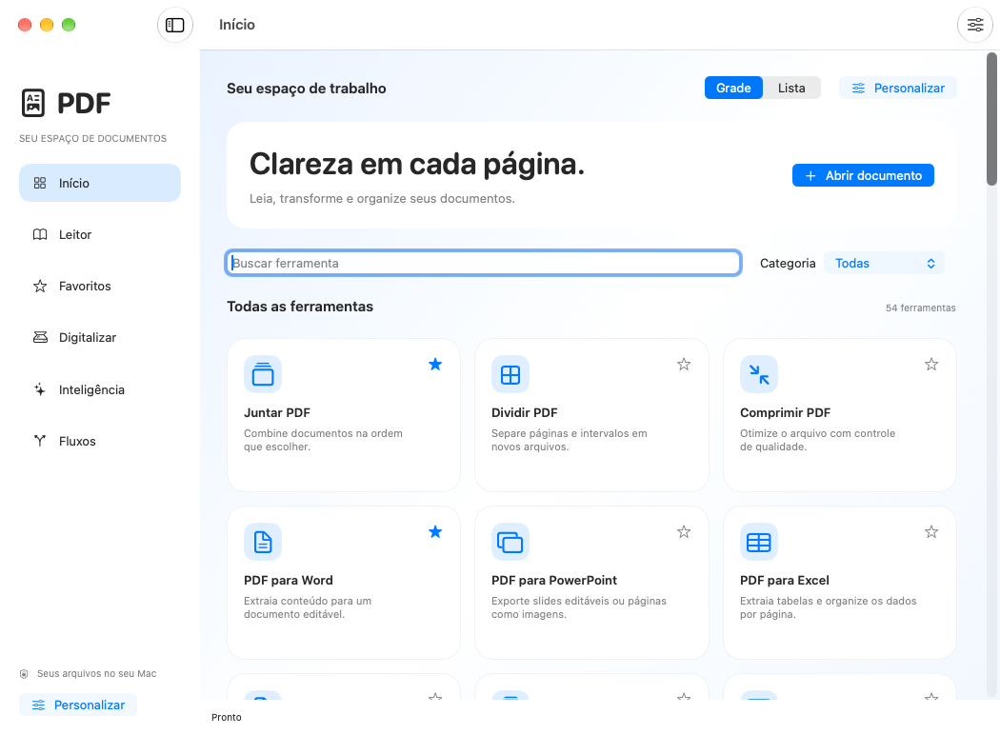

# PDF

Aplicativo nativo macOS, em português, com **71 ferramentas e leitor permanente**, SwiftUI/PDFKit e Liquid Glass. Preserva as 54 ferramentas anteriores e amplia edição, conversões, biblioteca, automação e produção de documentos.

**A versão 0.6 está em validação. Ainda não há um instalador portátil desta revisão aprovado para entrega.** A auditoria encontrou requisitos parcialmente atendidos e ensaios que dependem de macOS, M4 físico, modelo Apple ou serviço externo. O estado de cada requisito está na [matriz das 17 ampliações](docs/AMPLIACOES-2026-10.md); não há afirmação de ausência universal de erros ou superioridade comprovada a concorrentes.

## Estado verificável

- **Implementação:** catálogo com 71 entradas, mantendo todos os 54 IDs anteriores. Leitor com abas, comparação lado a lado, pesquisa, miniaturas, marcadores, anotações e recuperação.
- **Validação da ampliação:** `d0fda92` passou compilação, 268 testes de núcleo, 45 integrações, 75 testes de scripts e três execuções dos 37 grupos nativos no macOS 26; um teste Linux foi ignorado. As 32 capturas reais e cinco relatórios AX passaram e foram revisados. [Relatórios originais](docs/evidencias/d0fda92-macos26/README.md) e [VALIDACAO.md](docs/VALIDACAO.md) delimitam essa aprovação parcial.
- **Última base inteiramente aprovada no CI:** `5a11c07`, [execução 40055682837](https://github.com/vibracall-beep/PDF-/actions/runs/40055682837), macOS 26.6.2 e 27.0.1. Essa base é anterior às 17 ampliações.
- **Pendente:** a autenticação GitHub foi restabelecida. As matrizes recentes ainda reprovaram: `d0fda92` na desmontagem do volume de teste27 e no empacotamento26; `766fe59` numa comparação de caminhos do teste de certificados, antes de compilar. As correções seguem em validação; nenhum pacote portátil está aprovado.
- **Alcance:** runners M1 virtualizados não medem M4 físico, energia ou Neural Engine; inspeção AX automática não substitui uso humano com VoiceOver.

A [especificação original](docs/REQUISITOS.md), o [catálogo das imagens](docs/FERRAMENTAS.md), as [dez primeiras melhorias](docs/MELHORIAS.md) e a [auditoria histórica](docs/AUDITORIA-FERRAMENTAS.md) permanecem disponíveis.

## Menu e personalização



Esta é uma **captura real da base `5a11c07`**, em macOS 27.0.1; não representa as novas telas da versão 0.6. A [galeria histórica](docs/imagens/README.md) conserva procedência e hashes. A ampliação `d0fda92` produziu 32 capturas reais e cinco relatórios AX aprovados no macOS 26; as 32 imagens foram revisadas. Essa revisão revelou rótulos preenchidos pouco claros, corrigidos em `766fe59`; a aparência dessas correções ainda precisa de novas capturas.

O ambiente oferece busca, favoritos, categorias, nomes e ícones personalizados, ordem e visibilidade de ferramentas, aparência, densidade, opções de leitura e saída. A ampliação inclui arraste com alternativa por teclado, atalhos editáveis com verificação de conflitos, paleta de comandos e perfis de trabalho. Animações acompanham as mudanças e respeitam Reduzir Movimento. Veja [PERSONALIZACAO.md](docs/PERSONALIZACAO.md) e a [matriz atual](docs/AMPLIACOES-2026-10.md).

## Instalação

O alvo é Mac Apple Silicon com macOS 26 ou posterior, incluindo M4 e superiores. Não exige assinatura paga de desenvolvedor Apple; a assinatura é **ad hoc, sem notarização Apple**. As políticas do Gatekeeper permanecem ativas.

Existem dois caminhos, descritos em [INSTALACAO.md](docs/INSTALACAO.md):

- **Pacote autocontido 0.6:** empacotador e instalador por comando implementados, com runtime, dependências, checksum, atualização transacional e preservação de configurações. A validação em ambiente isolado, primeira instalação e atualização no Mac ainda precisam passar antes da entrega. Não exige Xcode, Homebrew ou Python no Mac de destino.
- **Compilação por fontes:** `bash scripts/install-mac.sh`, para desenvolvimento, exige Xcode/Swift e Homebrew arm64. Instala dependências, executa verificações e ativa o aplicativo somente após aprovação. A aprovação histórica pertence ao commit indicado, não a qualquer `main` futuro.

O pacote do GitHub Actions tem retenção limitada; isso não equivale a uma publicação permanente. Nenhum pacote marcado `unvalidated` deve ser tratado como a entrega final solicitada.

## Recursos e limites

| Área | Comportamento implementado e limites relevantes |
|---|---|
| Leitor | Abas, dois documentos lado a lado, estados de leitura independentes, pesquisa, impressão, formulários, edição de anotações e recuperação cifrada de documentos protegidos |
| Conteúdo original | Seleção visual de texto, parágrafos homogêneos e imagens, movimento, substituição, tamanho, alinhamento, espaçamento e aviso de fonte; layouts sobrepostos/recortados e objetos incompatíveis são recusados. Não é edição universal de todos os objetos PDF |
| Office e outros formatos | DOCX/XLSX/PPTX, imagens, TXT/RTF/CSV/ODT/EPUB/HTML/Markdown, tabelas e estilos disponíveis; auditoria de conversão reexporta Office por LibreOffice e compara aparência. Notas, cabeçalhos e fidelidade universal continuam parciais |
| OCR e scanner | Vision com fallback Tesseract identificado, OCRmyPDF, revisão lado a lado, tabelas com evidências de grade/alinhamento e compensação opcional de pequena inclinação; requer revisão. Scanner e Continuidade dependem dos dispositivos compatíveis |
| Biblioteca | Coleções, etiquetas, duplicados, pastas inteligentes, revisões imutáveis, comparação e restauração; pesquisa local controlada pelo usuário. Histórico depende de importação/adição explícita de versões |
| IA local | Resumos, tradução, perguntas, questionários e pesquisa em coleções com citações ligadas a documento/revisão/página; possíveis divergências entre fontes e recusa sem evidência. Exige modelo Apple disponível; citações válidas não provam toda interpretação. Ensaio real em português distingue aprovação, falha e indisponibilidade |
| Assinaturas | Assinatura visual, PKCS#12/PAdES, verificação de integridade, OCSP/CRL, TSA e perfis LT/LTA opcionais. Confiança depende de raízes/evidências e provedor configurados; não é certificação jurídica |
| Solicitações | Participantes, campos, revisão, envio e acompanhamento via Dropbox Sign com consentimento explícito; credencial no Keychain. Testes locais não comprovam entrega externa. O link Sign.com anterior permanece |
| Segurança | AES-256, desbloqueio com senha conhecida, remoção permanente de conteúdo nas regiões de redação, publicação de cópias sem sobrescrever originais e verificação estrutural. Recortar apenas muda a área visível |
| Padrões e acessibilidade | PDF/A e validação independente veraPDF, auditoria PDF/UA, edição de tags existentes/ordem/alternativas e criação manual limitada de estrutura. Regras aprovadas não substituem revisão semântica humana |
| Fluxos e macOS | Lotes com saída final Office/imagens/Markdown, cancelamento, atalhos editáveis, App Intents, Serviços do Finder e pastas monitoradas com adesão explícita. Metadados App Intents passaram nos dois SDKs; interação pela interface do Atalhos ainda não foi comprovada |
| Sincronização | Documentos e snapshots de preferências/perfis/marcadores por pasta escolhida; conflitos são preservados e configurações só são aplicadas explicitamente. PDFs comuns/metadados não recebem criptografia ponta a ponta adicional |
| Produção | Diagnóstico de fontes/DPI, caixas, corte/sangria, candidato PDF/X-3 com ICC CMYK; Bates, índices navegáveis, carimbos e medidas por escala. Não há certificação independente PDF/X nem calibração física automática |
| Recursos Apple | Concorrência ajustada a CPU/memória estimada/temperatura/baixo consumo, Core Image/Metal e Vision conforme disponibilidade; benchmark registra hardware, backend e métricas. Orçamento de memória não é limite imposto pelo sistema; NPU e energia não foram medidos |

Pages continua requerendo o aplicativo Pages e autorização de Automação. EPUB não remove DRM. Edição/conversão produz novos bytes, que não preservam a validade criptográfica de assinaturas sobre o original. Os limites completos e a correspondência com testes estão na [matriz atual](docs/AMPLIACOES-2026-10.md).

## Desenvolvimento e verificações

Use o checkout existente em `/workspace/PDF-`, sem criar worktrees salvo pedido explícito.

```bash
bash scripts/setup-cloud.sh
.venv/bin/python engine/pdf_engine.py --capabilities
.venv/bin/python -m unittest discover -s tests -p 'test_*.py'
PDF_CHROMIUM_EXECUTABLE=/usr/bin/chromium .venv/bin/python -m unittest discover -s tests -p 'integration_*.py'
.venv/bin/python -m unittest discover -s scripts -p 'test_*.py'
```

Integrações exigem as dependências reais descritas no instalador: LibreOffice, OCRmyPDF, Tesseract, Ghostscript, Chromium, pyHanko, Java e veraPDF fixado. O Linux desta tarefa tem OCR inglês; use `language=eng` nele. O instalador macOS inclui português/inglês. HTML remoto acessa os recursos da página. Serviços externos exigem configuração própria; credenciais não devem aparecer em comandos, logs ou no chat.

Para senhas e opções privadas, use `PDF_OPTIONS_STDIN=1` com JSON em stdin. A interface usa descritor de arquivo privado `0600` cujo nome é removido antes da execução, não um argumento de linha de comando. Esse transporte não é RAM criptografada. Jobs qpdf privados podem conter texto/credenciais e são limpos nos caminhos tratados; crash pode deixar temporários. Recuperação persistente protegida conserva criptografia. A biblioteca conserva os bytes da fonte. Capturas de scanner permanecem em `~/Library/Application Support/PDF/Capturas`; remover um item da lista não apaga o original.

```bash
.venv/bin/python engine/pdf_engine.py organize entrada.pdf --output organizado.pdf --options '{"pages":"3,1-2"}'
bash scripts/package-source.sh
```

O pacote de fontes inclui manifesto e checksum, exclui runtimes/caches/credenciais e identifica alterações locais. **Não é um aplicativo macOS compilado.** PyMuPDF possui licenciamento AGPL/comercial; o projeto ainda não define uma licença própria.
