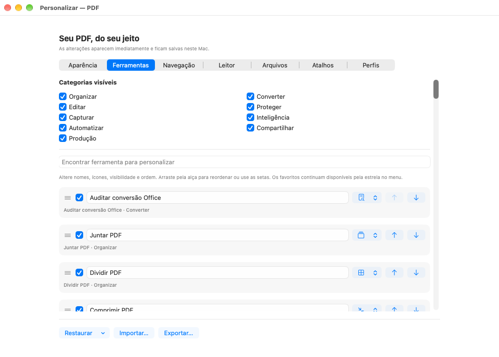
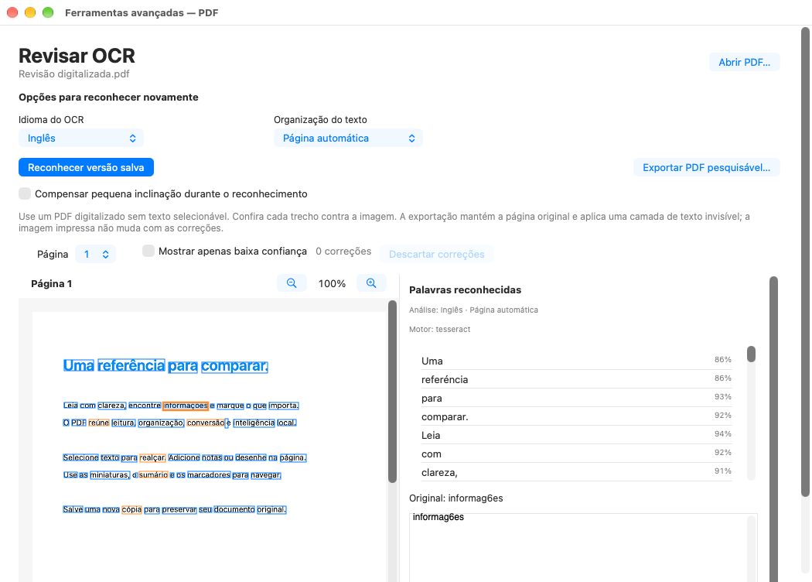

# Binário do macOS 26 instalado e validado no macOS 27

A [execução cruzada 40141728214, tentativa 1](https://github.com/vibracall-beep/PDF-/actions/runs/40141728214) concluiu **com sucesso**. O controle `6daf46294b10f35ec8252fd473f1d0865cd4bf8f` instalou no macOS 27 o mesmo tar produzido pela [matriz 437a8f4](../437a8f4/README.md), sem recompilar, substituir o executável ou instalar dependências do host.

- Fonte do aplicativo: `437a8f4d6bb6ebb003859f769e3756fce30c9da3`, run `40137438618`.
- Artefato binário original: `12578358642`, produzido no macOS 26.
- Tar: **1.448.521.887 bytes**, SHA-256 `7dabd68ffcc1b65ea551efd51bb17f9194bb6d3990261f6c52e33735d96cb7ad`.
- Destino registrado: **macOS 27.0.1, Apple M1 virtual, arm64, três CPUs lógicas**.

## O que passou

A origem da matriz e do artefato foi autenticada antes da instalação. O hash independente, o manifesto interno e o manifesto publicado coincidiram; as 56.817 entradas e a identidade do executável permaneceram vinculadas ao arquivo aprovado.

Passaram instalação nova, validação do runtime com rede e dependências externas negadas, metadados App Intents e operações nativas. Os logs completos contêm **três execuções de 41 grupos nativos: 123 grupos aprovados, zero falhas**. Os testes do controle foram **9 métodos em 0,051 s e 11 em 0,368 s**, todos aprovados. Essas repetições e os 20 métodos do controle não foram adicionados aos 491 métodos distintos da matriz principal.

A interface do binário instalado foi capturada **uma vez**, com prazo de 300 segundos, **fora do sandbox de dependências**. O isolamento do runtime passou em uma etapa anterior separada. Foram validados **32 PNGs, seis relatórios AX da própria janela e dois originais OCR**. O recibo confronta o tar e o executável antes/depois, hashes dos scripts da fonte autenticada e todos os arquivos capturados.

## Revisão dos originais

As 32 imagens foram abertas individualmente depois da execução: [índices 00–15](visual-review-00-15.json) e [16–31](visual-review-16-31.json). Não foi encontrado novo bloqueador visual nas áreas capturadas. O menu, os controles visíveis do editor e o título **“Palavras reconhecidas”** estão íntegros; a Biblioteca apresenta **“1 versão”**. Os relatórios são derivados locais e não alteram o campo `humanVisualReview: false` do recibo original produzido antes dessa revisão.

Estas três imagens são cópias byte a byte dos membros do ZIP original:

| Menu inicial | Personalização das ferramentas | Revisão OCR |
| --- | --- | --- |
| [Abrir original](PDF-preview.png) | [Abrir original](PDF-preview.ferramentas.png) | [Abrir original](PDF-preview.revisao-ocr.png) |

Na [análise técnica do OCR](ocr-macos26-binary-on27.json), o PDF original tem uma página raster de 1130 × 1600, sem texto selecionável. As 60 palavras têm IDs únicos, hashes correspondentes, confiança finita e caixas dentro da página. O controle **Inglês / Página automática** corresponde a `eng`/PSM 3, 200 DPI, confiança mínima zero e deskew desativado; o motor exibido é Tesseract.

O raster contém português, e erros reais como `informag6es` e `retne` continuam visíveis para correção. Confiança alta não garante transcrição correta. A análise abriu tanto a renderização da fonte original quanto a captura OCR, sem modificar PDF, JSON ou PNG.

## Originais e procedência

- [ZIP original do artefato, 48 membros](original-artifact.zip): **3.320.598 bytes**, artefato `12580060577`, SHA-256 `daa8a6f16902247791a22d668e96bcb5287a5cdab522ff8f9cbd01b806cf114e`.
- [ZIP oficial dos logs da tentativa](attempt-1-logs.zip): **78.586 bytes**, SHA-256 `8bf7fb32b21fc0b2223bd74510dc506e5c724014298ca1a312929329098e7d5e`. O log completo obtido por job é byte a byte igual ao membro de topo desse ZIP.
- [Origem autenticada](PDF-cross-origin.json), [verificação do arquivo](PDF-cross-verified.json) e [relatório cruzado](PDF-cross-platform.json).
- [Identidade anterior à captura](PDF-cross-gui-before.json) e [recibo GUI original](PDF-cross-gui.json).
- Logs originais: [isolamento](PDF-cross-isolation.log), [captura](PDF-cross-gui-capture.log) e [gate dos originais](PDF-cross-gui-validation.log).
- [Contagens derivadas dos logs completos](final-counts.json) e [procedência, inventário e hashes](provenance.json).

Os 13 arquivos originais preservados separadamente incluem os dois ZIPs, oito recibos/logs e três PNGs. Os quatro relatórios de contagem/OCR/revisão visual são derivados. O ZIP do artefato conserva também todos os demais PNGs, AX e os dois arquivos OCR; o tar binário não foi duplicado nesta pasta.

A triagem de 37 entradas de texto não encontrou os padrões selecionados de tokens, URLs temporárias assinadas, valores de autorização ou chaves privadas. Os bytes originais foram preservados, incluindo diagnósticos de fixtures e caminhos do runtime. Essa triagem não prova ausência de toda forma possível de segredo.

## Limites da aprovação

Esta é uma prova de instalação, funcionamento isolado e captura desse binário no sistema de destino registrado. Não mede um M4 físico, energia ou uso efetivo da Neural Engine. As imagens não testam interação, animações, redimensionamento, rolagem fora do viewport nem VoiceOver humano. A avaliação de modelos Apple e os demais limites da matriz principal continuam nos [relatórios de origem](../437a8f4/README.md).

A assinatura permanece ad hoc, sem notarização Apple. Dispositivos físicos, Pages real e serviços externos com credenciais exigem suas próprias condições de uso. O sucesso desta execução não publica uma release: a retenção e conferência dos arquivos de entrega pertencem a uma etapa separada.
