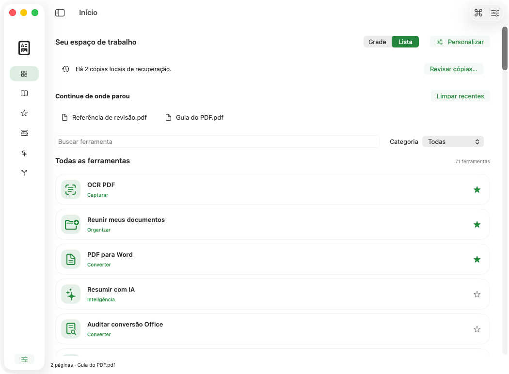
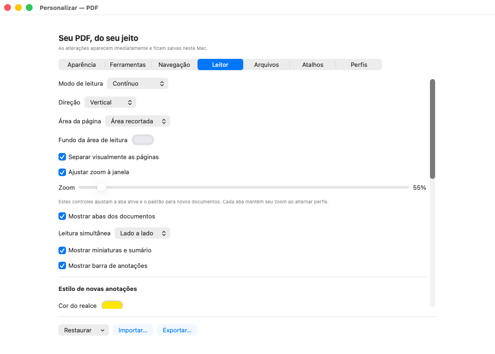
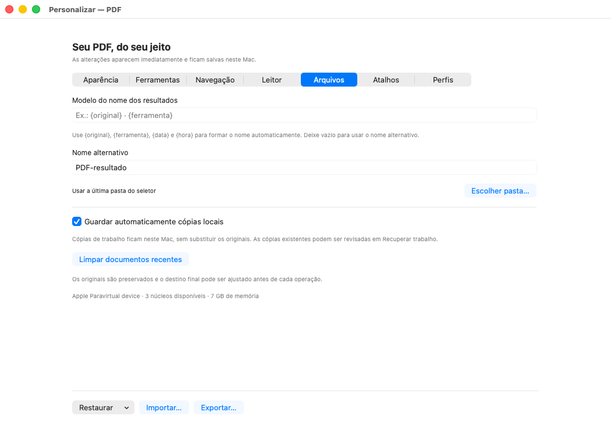
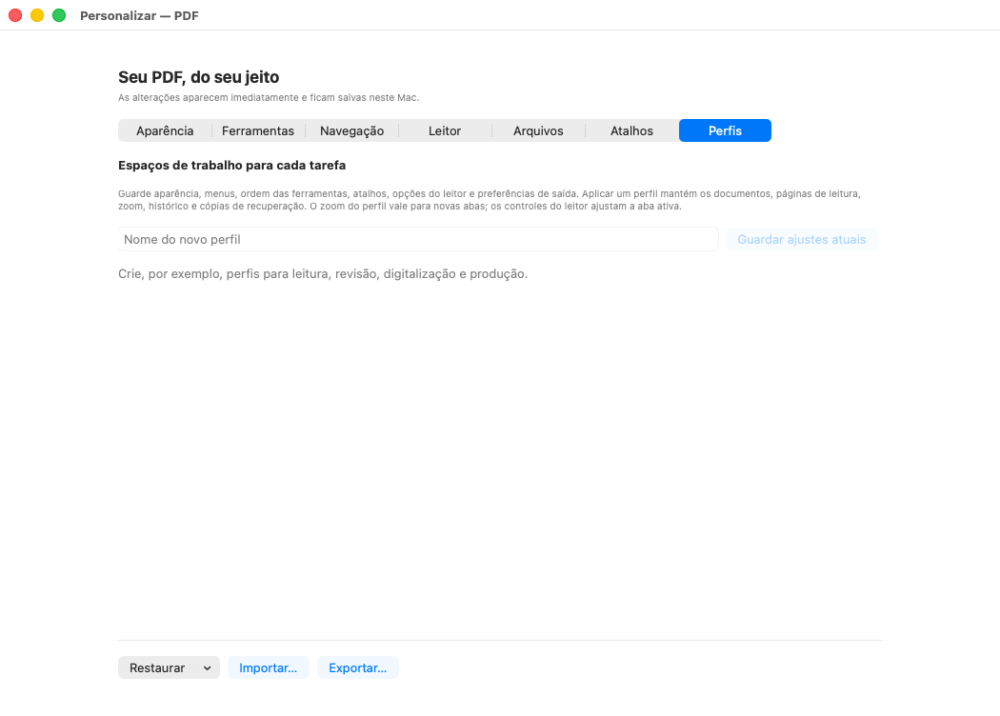
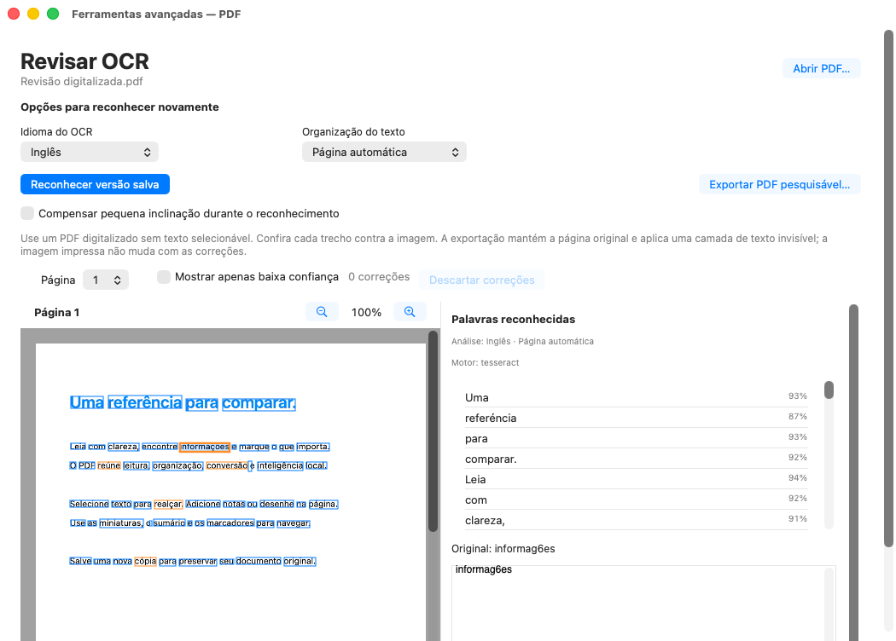
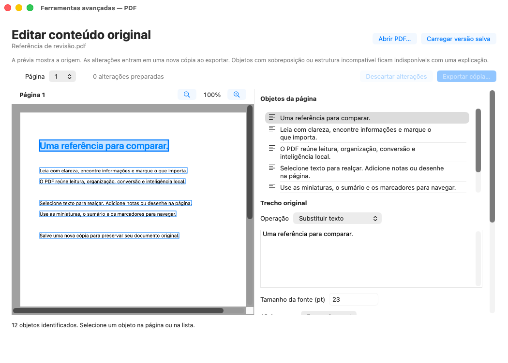
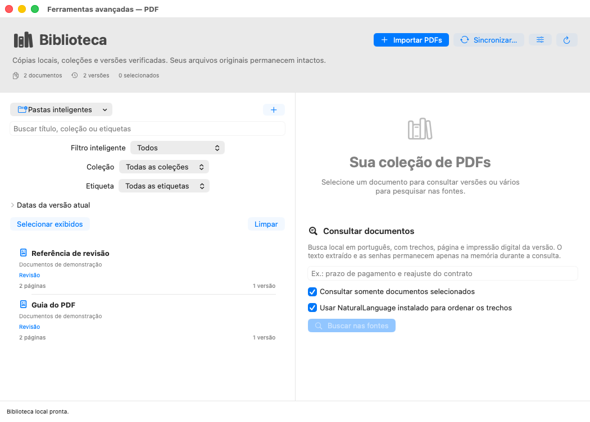

# Menu, personalização, editor e OCR — capturas reais 437a8f4, macOS 26

Estas **13 imagens originais** vêm do commit [`437a8f4d6bb6ebb003859f769e3756fce30c9da3`](https://github.com/vibracall-beep/PDF-/commit/437a8f4d6bb6ebb003859f769e3756fce30c9da3), na [execução 40137438618, tentativa 1](https://github.com/vibracall-beep/PDF-/actions/runs/40137438618). Mostram a janela real do aplicativo instalado por fontes, com documentos de demonstração e preferências isoladas. Os PNGs foram copiados byte a byte dos membros do ZIP original verificado, **sem recorte, redimensionamento, retoque ou recomposição**.

**Esta galeria não aprova o aplicativo nem o instalador.** A matriz ainda estava em execução no momento do registro de procedência. A conclusão do pacote e a prova de execução do mesmo binário do macOS 26 no macOS 27 são verificações separadas.

As revisões individuais abrangem **32 originais do macOS 26 e 32 do macOS 27**. Nos estados mostrados, os dois relatórios registram o cabeçalho **“Palavras reconhecidas”** inteiro, o rótulo **“Tamanho da fonte (pt)”** visível e a Biblioteca com **“1 versão”** por documento. Não foi identificado novo defeito de layout nesses estados; isso não demonstra ausência de erros em outras telas ou durante interação. A galeria abaixo seleciona somente imagens do macOS 26.

**Ressalvas preservadas:** formulários e listas mostram apenas o trecho visível de áreas roláveis. As imagens não demonstram ações, animações, rolagem até o fim, redimensionamento ou uso humano com VoiceOver. O OCR usa Tesseract com `eng` e PSM 3, coerentes com **Inglês / Página automática**, mas mantém erros reais no texto português, como `informag6es` para “informações”. A correção do layout não aprova a precisão do reconhecimento.

- Artefato da galeria: **12578054234**, `PDF-macOS-preview-macos-26`, criado em `2026-10-24T22:33:15Z`.
- ZIP original: **3.279.109 bytes**, SHA-256 `99161050945e84a080ee4e799fe07a9c7a24a42ad1fc947858d06cbdfa598182`, conferido contra o digest do GitHub.
- [Procedência, hashes, tamanhos e dimensões](proveniencia.json).
- Relatórios derivados preservados sem reserialização: [32 imagens do macOS 26](visual-review-macos26-all32.json) e [32 imagens do macOS 27](visual-review-macos27.json). Os caminhos `/tmp` nesses relatórios identificam o ambiente da revisão; os arquivos não são PNGs nem recibos de aprovação do produto.
- Galerias históricas preservadas: [e9af24a](../e9af24a/README.md), [75d5012](../75d5012/README.md), [4ac9d26](../4ac9d26/README.md) e [5a11c07](../README.md).

## Menu inicial

## Menu no tema escuro

## Menu em lista

## Personalização da aparência

## Personalização das ferramentas

## Personalização da navegação

## Personalização do leitor

## Personalização dos arquivos

## Personalização dos atalhos

## Perfis de trabalho

## Revisão visual de OCR

O cabeçalho do painel está inteiro. O erro de reconhecimento permanece visível no original e pode ser comparado com a página à esquerda; nenhum texto da captura foi retocado.

## Editor do conteúdo original

O inspetor mostra o rótulo persistente do tamanho da fonte; controles inferiores continuam na área rolável. Esta imagem não executa uma edição ou exportação.

## Biblioteca de documentos

Cada um dos dois documentos mostra “1 versão”. A captura registra esse estado visual, sem comprovar pesquisa, sincronização ou restauração.

