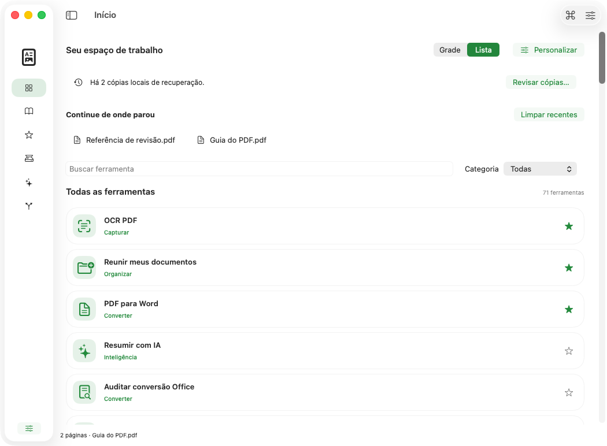
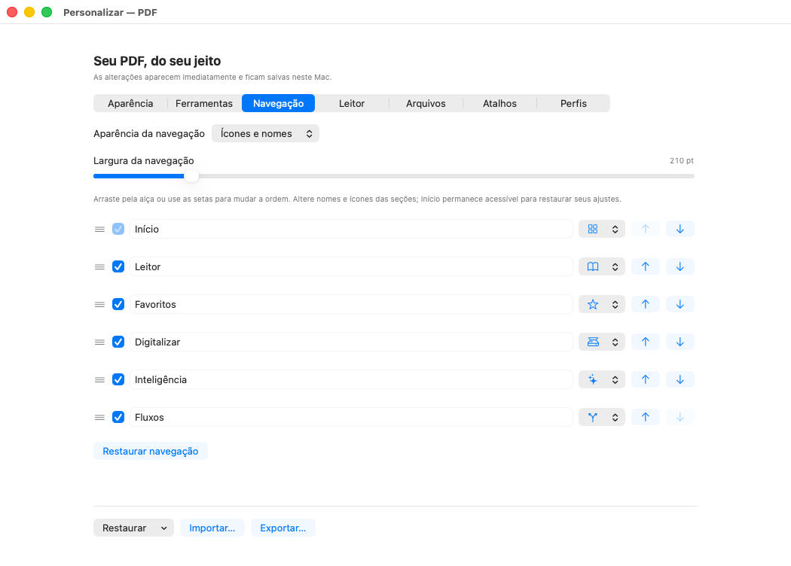
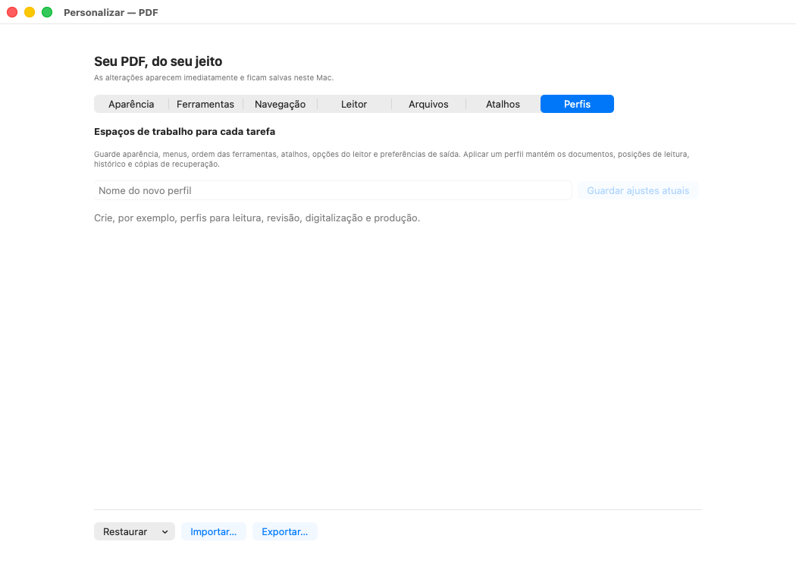

# Menu e personalização — capturas reais 4ac9d26, macOS 26

Estas dez imagens mostram o menu e os sete painéis de personalização do commit **`4ac9d264473fd5440df4d67bfa6cf2e702d8d3bf`**, na [execução 40114980785, tentativa 1](https://github.com/vibracall-beep/PDF-/actions/runs/40114980785). Foram copiadas dos PNGs originais do artefato `PDF-macOS-preview-macos-26`, sem recorte, redimensionamento, retoque ou recomposição. A captura usa a janela real do aplicativo, documentos de demonstração e preferências isoladas.

**Esta rodada foi reprovada.** O formulário de acessibilidade apresentou o seletor Scope sem nome na árvore AX; o pacote portátil também falhou. O macOS 27 não produziu capturas antes do timeout. Portanto, estas imagens são exclusivamente do **macOS 26** e não aprovam acessibilidade completa, VoiceOver humano ou distribuição do pacote. As correções posteriores dos rótulos AX ainda não aparecem aqui. [Resultados e evidências originais](../../evidencias/4ac9d26/README.md).

Os 32 PNGs desse artefato foram revisados individualmente sem nova regressão visual observada; esta galeria seleciona dez estados. Painéis roláveis mostram somente a parte visível no instante da captura. O painel Perfis mostra o estado inicial sem perfis salvos, não a execução de um perfil.

- Artefato: **12569660236**, criado em `2026-10-24T17:33:27Z`, ZIP com **3.180.823 bytes**.
- SHA-256 do ZIP, conferido contra o digest do GitHub: `2613172d3b99a239b06524da5ab378783deee75c4575c2bcff0fd582b4bf8ddc`.
- [Manifesto com SHA-256, tamanho e dimensões de cada PNG](proveniencia.json).
- A [galeria histórica 5a11c07](../README.md) permanece preservada.

## Menu inicial

## Menu no tema escuro

## Menu em lista

## Personalização da aparência

## Personalização das ferramentas

## Personalização da navegação

## Personalização do leitor

## Personalização dos arquivos

## Personalização dos atalhos

## Perfis de trabalho

