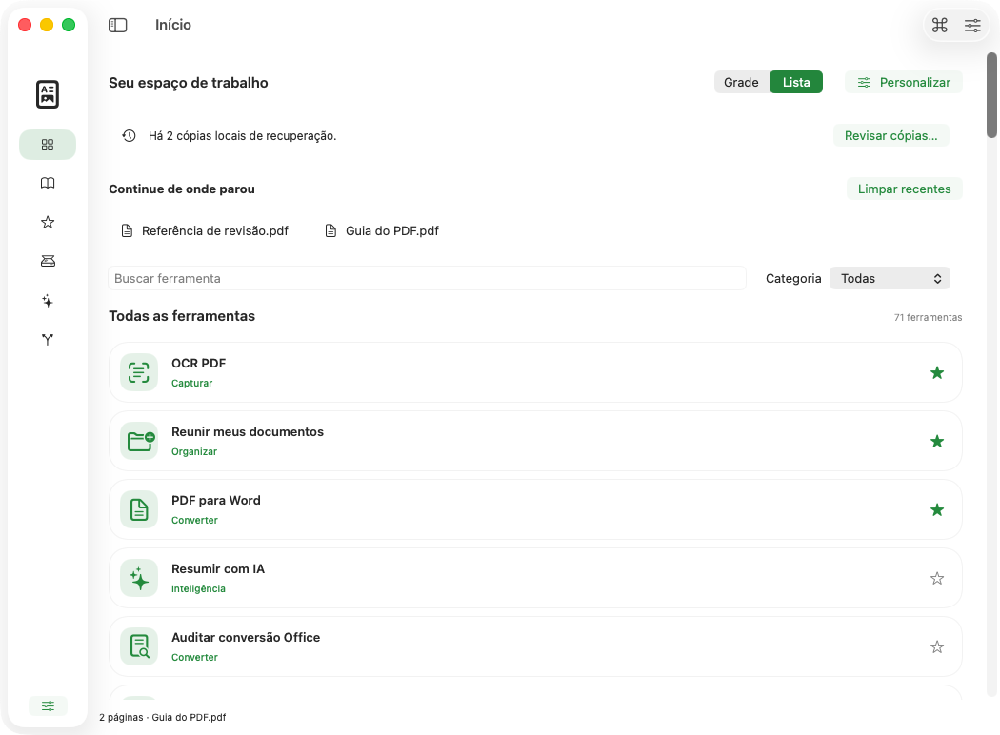
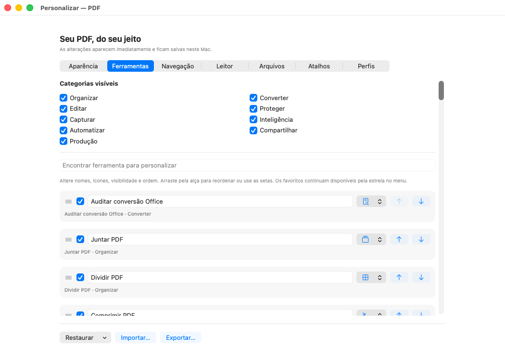
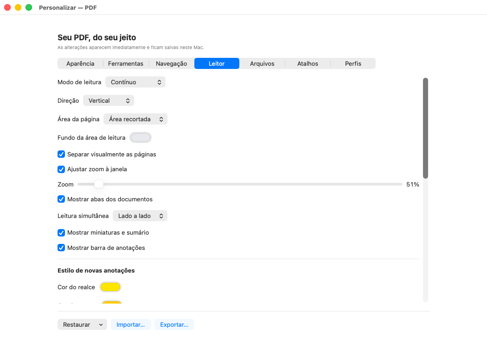
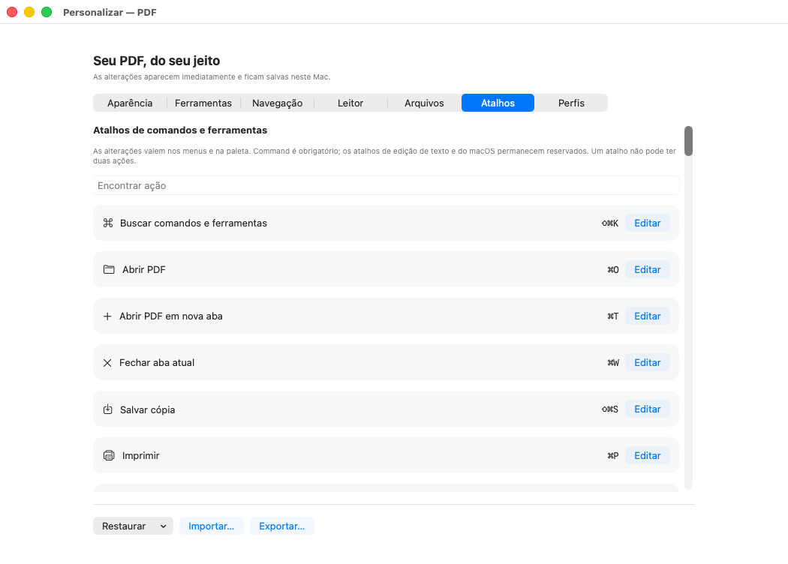

# Menu e personalização — capturas reais 75d5012, macOS 26

Estas dez imagens mostram o menu e os sete painéis de personalização do commit **`75d5012cc31032bd953e2075dacf2e81c541a591`**, na [execução 40121275705, tentativa 1](https://github.com/vibracall-beep/PDF-/actions/runs/40121275705). Foram copiadas dos PNGs originais do artefato `PDF-macOS-preview-macos-26`, sem recorte, redimensionamento, retoque ou recomposição. A captura usa a janela real do aplicativo, documentos de demonstração e preferências isoladas.

**Esta rodada foi reprovada no isolamento do Office nos dois sistemas.** Os gates de captura e validação automática de 32 PNGs e seis relatórios AX passaram em cada Mac, mas isso não aprova o instalador, a distribuição do pacote ou o uso humano com VoiceOver. [Resultados e evidências originais](../../evidencias/75d5012/README.md).

Os 64 originais — 32 do macOS 26 e 32 do macOS 27 — foram revisados sem novo corte ou sobreposição dos controles fixos. O tema escuro do macOS 26 agora aparece nítido, em 1050 × 772 pixels. **A revisão manteve uma ressalva no OCR:** a tela correspondente mostra palavras reconhecidas incorretamente e resultado `eng` enquanto o seletor exibe Português + inglês. Essa captura não comprova precisão do OCR nem concordância de configuração; a ressalva está em investigação. Esta seleção de dez imagens é exclusivamente do macOS 26 e não inclui a tela de OCR.

Painéis roláveis mostram somente a parte visível no instante da captura. O painel Perfis mostra o estado inicial sem perfis salvos, não a execução de um perfil. As correções posteriores ao commit indicado não aparecem nestas imagens.

- Artefato: **12571732833**, criado em `2026-10-24T18:53:36Z`, ZIP com **3.181.026 bytes**.
- SHA-256 do ZIP, conferido contra o digest do GitHub: `68fabdb56d927f4da7939a88b54ab99391e1431f781ad49edc6549ab0be22b06`.
- [Manifesto com procedência, SHA-256, tamanho e dimensões de cada PNG](proveniencia.json).
- As galerias históricas [4ac9d26](../4ac9d26/README.md) e [5a11c07](../README.md) permanecem preservadas.

## Menu inicial

## Menu no tema escuro

## Menu em lista

## Personalização da aparência

## Personalização das ferramentas

## Personalização da navegação

## Personalização do leitor

## Personalização dos arquivos

## Personalização dos atalhos

## Perfis de trabalho

