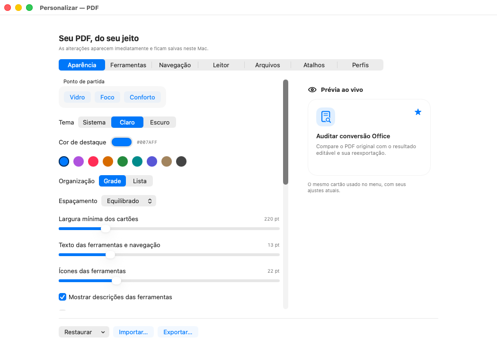
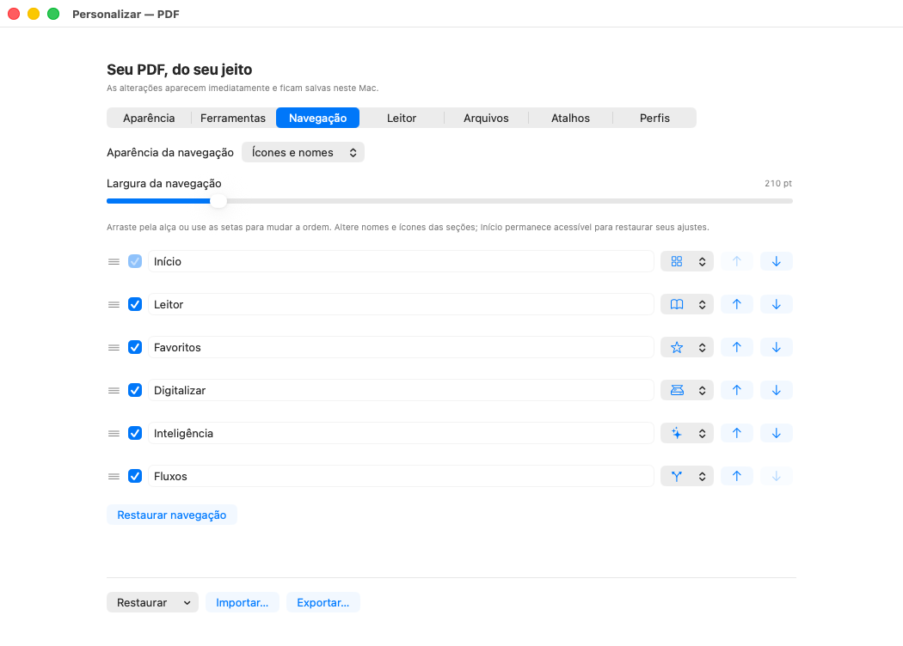
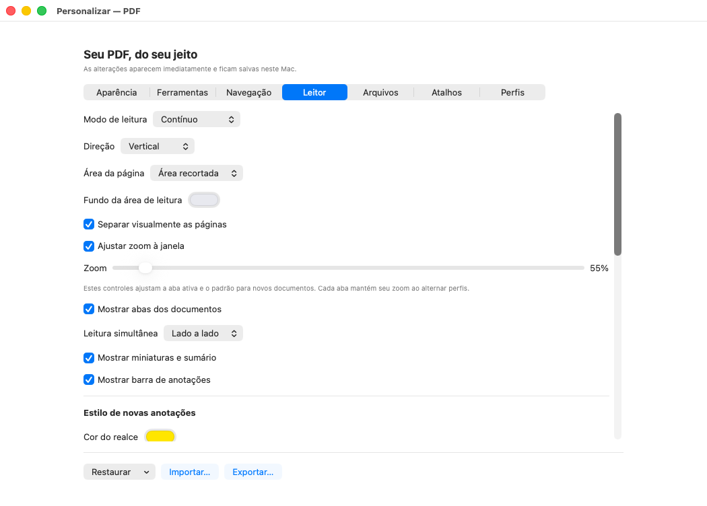
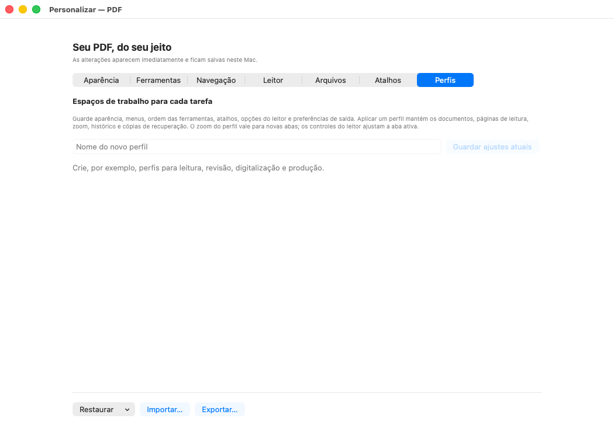
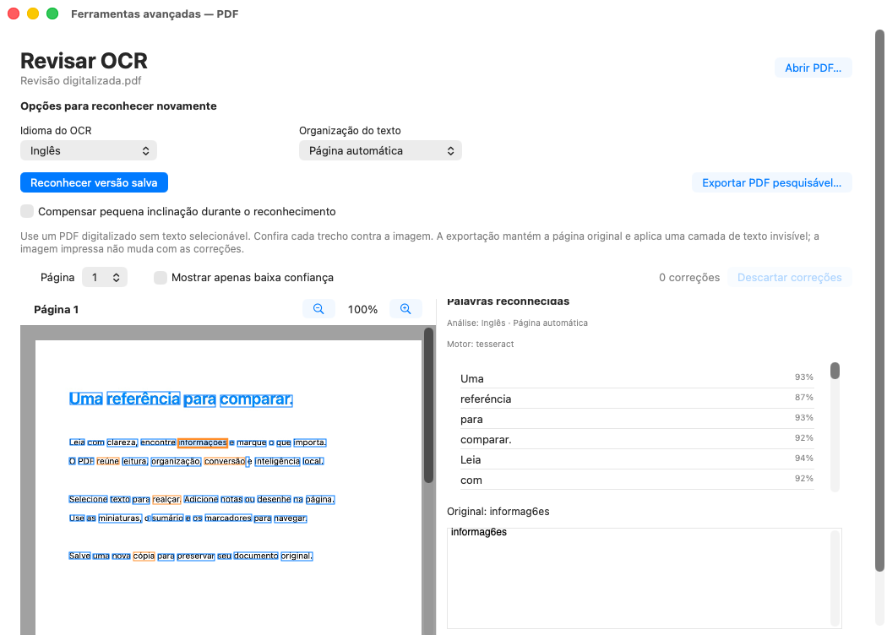

# Menu, personalização e OCR — capturas reais e9af24a, macOS 26

Estas **11 imagens originais** vêm do commit [`e9af24a1bd9babe886ec74a9d96e97feb153a2bf`](https://github.com/vibracall-beep/PDF-/commit/e9af24a1bd9babe886ec74a9d96e97feb153a2bf), na [execução 40130449411, tentativa 1](https://github.com/vibracall-beep/PDF-/actions/runs/40130449411). Mostram a janela real do aplicativo instalado por fontes, com documentos de demonstração e preferências isoladas. Cada PNG foi copiado byte a byte do artefato verificado, **sem recorte, redimensionamento, retoque ou recomposição**.

**A rodada e o pacote portátil foram reprovados.** O macOS 26 produziu 32 PNGs e seis relatórios AX aprovados pelo gate automático. No macOS 27, a captura expirou: **zero imagens e zero relatórios AX**; não existe galeria dessa plataforma para esta rodada. O smoke portátil falhou nos dois sistemas e a instalação/atualização binária posterior não foi executada. [Resultados e evidências originais](../../evidencias/e9af24a/README.md).

As **32 telas originais do macOS 26 foram revisadas individualmente**. Uma segunda inspeção, durante a rodada `352ae6f`, confirmou um defeito que a primeira revisão não identificou: o topo do título da interface **“Palavras reconhecidas”** está cortado no painel OCR. O mesmo corte aparece nesta amostra histórica; a correção posterior ainda precisa de validação. Esta galeria seleciona o menu em três apresentações, os sete painéis de personalização e a revisão OCR. Conteúdo rolável mostra apenas o trecho visível. Capturas estáticas não demonstram execução de ações, animações ou uso humano com VoiceOver. Correções posteriores ao commit indicado não aparecem aqui.

**Ressalvas mantidas:** a revisão OCR usa Tesseract com `eng` e PSM 3, coerentes com os controles **Inglês / Página automática**, mas reconhece texto português com erros reais, como `informag6es` e `retne`. Confiança alta não garante acerto. A captura não aprova a precisão geral do OCR. A Biblioteca, fora desta seleção, mostra **“1 versões”** em dois pontos; esse achado também permanece registrado.

- Artefato **12575406649**, `PDF-macOS-preview-macos-26`, criado em `2026-10-24T20:54:24Z`.
- ZIP original: **3.284.185 bytes**, SHA-256 `74fdf4a489b80973da9f893796d93e9c45131cde3f956f5c1d2d4029b11701ae`, conferido contra o digest do GitHub.
- Recuperação pela [retenção parcial 40132887159](https://github.com/vibracall-beep/PDF-/actions/runs/40132887159), draft **422983201**, asset **673319503**. Os [metadados do draft](https://api.github.com/repos/vibracall-beep/PDF-/releases/422983201) exigem acesso autenticado; o rascunho não é uma publicação do aplicativo.
- [Procedência, hashes, tamanhos e dimensões dos 11 PNGs](proveniencia.json).
- Galerias históricas preservadas: [75d5012](../75d5012/README.md), [4ac9d26](../4ac9d26/README.md) e [5a11c07](../README.md).

## Menu inicial

## Menu no tema escuro

## Menu em lista

## Personalização da aparência

## Personalização das ferramentas

## Personalização da navegação

## Personalização do leitor

## Personalização dos arquivos

## Personalização dos atalhos

## Perfis de trabalho

## Revisão visual de OCR

O idioma e a organização do texto estão identificados. Os erros de reconhecimento permanecem visíveis no original, inclusive no trecho selecionado; esta imagem não foi corrigida para apresentação.

